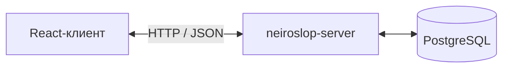

# neiroslop-client

Клиентская часть учебного проекта «Виртуальное казино — NEIROSLOP BURMALDA». Браузерное приложение построено на React и Vite и работает с виртуальными монетами без денежных платежей.

## Назначение

Клиент отвечает за каталог семи игр, навигацию, анимацию игровых автоматов, управление ставками, отображение кошелька и истории. Светлая и тёмная темы, смена фона и звуковое сопровождение настраиваются независимо от игровых правил.

## Место в архитектуре

Клиент получает каталог, баланс и результаты через API. Авторитетный расчёт выигрышей, проверка ставок и сохранение состояния выполняются сервером. Браузер отображает результат и не подключается к базе данных.

В опубликованном репозитории исходный код, проверки и публичные ресурсы находятся в `client/`, а конфигурация сборки — в корне. Документация графики и звука находится в `docs/`.

## Связанные компоненты

- [neiroslop-server](https://github.com/dashkalikov/neiroslop-server) — API, игровые правила и операции с балансом.
- [neiroslop-database](https://github.com/dashkalikov/neiroslop-database) — описание данных и средства для PostgreSQL.

## Совместная работа

Изменения предлагаются через pull request из рабочих веток в `main`. Целевые правила требуют одобрения другого участника, повторного одобрения после новых коммитов и закрытия обсуждений. Прямые push в `main`, force push и удаление ветки должны быть запрещены для всех участников, включая администраторов. Правила применяются в настройках GitHub.

CI/CD будет добавлен отдельным этапом.

Общий обзор проекта: [архитектура](../docs/architecture.ru.md).
